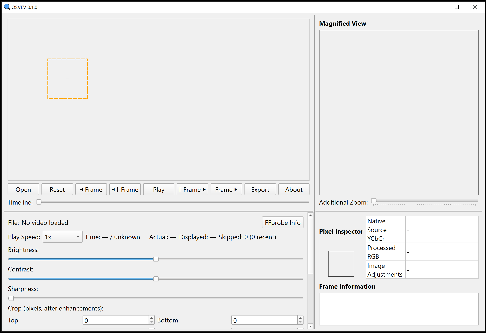

# OSVEV - Open Source Video Enhancement Visualizer

### Development Transparency
This application was developed with AI assistance and has undergone human review and testing. The program itself does not use AI. As with any AI-assisted software, additional scrutiny and verification are recommended before critical use.

---

OSVEV is a tool for visualizing the effects of different video adjustment filters and enhancements.

⚠️ **OSVEV is in active development. Use it as an inspection and teaching aid; verify all findings independently.** See [Important Disclaimers](#important-disclaimers).

## Download

Download the latest `OSVEV.exe` for Windows from the
[Releases](https://github.com/btc-git/osvev/releases/latest) page. Each release
lists a SHA-256 checksum. Compare the checksum before running the executable. `OSVEV.exe` is
not code-signed, so Windows SmartScreen may warn the first time it runs
(**More info** -> **Run anyway**). No Python, conda or FFmpeg installation is
needed for the packaged executable.

## Privacy & Security

- OSVEV works offline. It does not upload videos, frames, logs or usage data.
  Links in **About** and the export dialog open in your web browser only when
  clicked.
- Opening a video does not modify it. Exports and working copies are written
  as new files.
- Export logs, optional JSON/JSONL verification files and working-copy logs
  record full source and output paths, file names, hashes and build details.
  Folder names may identify cases or clients; review these files before
  sharing them.

## Important Disclaimers

- **This tool is in continuous development and may contain errors.**
- The Main View, Magnified View, interpolation, highlights and JPEG simulation
  are visual aids. Only exports verified as described in
  [Export and reproducibility](docs/EXPORTING.md) carry OSVEV's documented
  verification claims, and only within those stated limits.
- FFprobe Info and the file row report header values from the file; they are
  not verified against decoded frames.
- Work from a copy of original recordings and preserve the original with its
  hash.
- This tool does not replace professional forensic video analysis, validated
  laboratory procedures or expert review.

## Quick Start

1. Download `OSVEV.exe` from [Releases](https://github.com/btc-git/osvev/releases/latest)
   and compare its SHA-256 checksum (see [Download](#download)).
2. Run `OSVEV.exe`, click **Open**, select a video, then choose **Entire Video**
   (default) or **Selected Time Range** for part of a long video.
3. Adjust brightness, contrast, sharpness, crop, rotation and zoom; use the
   magnifier and Pixel Inspector to examine pixels.
4. Click **Export** for verified PNG or FFV1/MKV output, or lossy H.264/MP4,
   each with a processing log.
5. Use **About** for the version, commit, FFmpeg build and licenses.

To run or build from source, see [Building from source](docs/BUILDING.md).

## Features

- Frame-by-frame navigation
- Variable playback speed
- Advanced magnification with multiple interpolation methods:
  - Nearest neighbor
  - Bilinear
  - Bicubic
  - Lanczos
- Image adjustments:
  - Brightness and contrast via standard FFmpeg `eq` on explicit full-range
    BT.709 YUV444 luma (`brightness=slider/100`, `contrast=1+slider/100`),
    then conversion back to BGR; not the legacy OpenCV adjustment algorithm
  - Sharpness adjustment (FFmpeg 5x5 luma unsharp)
  - Exact top/bottom/left/right pixel crop, after enhancements, without output resizing
  - **Rotate** (0° Original, 90° clockwise, 180°, 270° clockwise): exact 90-degree
    pixel rotation after crop and before Zoom Level, without interpolation; applied
    to the Main View, Magnified View, Pixel Inspector mapping and verified exports
  - JPEG compression teaching simulation (after the core enhancements)
- Detailed frame information panel
- **File** row above Play Speed: the loaded file's name (hover for the full path;
  click to show it selected in its folder), labeled **Codec**, **Resolution**,
  **Avg FPS** and **Size** attributes, and an **FFprobe Info** button that opens a list of container
  and stream header values (full path, container, brands, writing application,
  codec profile/level, duration, bit rates, frame rates, color tags, audio streams), with Copy and
  Show in Folder. These values are read once by FFprobe when the video is loaded;
  they are reported header values and are not verified against decoded frames.
  Resolution is before crop/rotation/zoom; average FPS is not playback speed or
  a claim of constant frame rate. Unreported values are not guessed. Attributes
  wrap when needed, and the dark-blue filename is shortened to fit.
  After a working-copy conversion the row identifies the loaded working copy.
- Pixel Inspector with two value rows plus Image Adjustments
  - **Native Source YCbCr** (or **Native Source RGB** for native RGB sources):
    decoded source samples at the crosshair's source pixel, unchanged by enhancements
  - **Processed RGB**: the processed pixel under the Main View crosshair after
    enhancements, crop, Zoom Level and the selected interpolation
- **Inspection Aids (Preview Only)** control group: Highlight Original Pixels /
  Highlight Interpolated Pixels (schematic, display-only) and JPEG Compression
  Simulation; both are excluded from exports and working copies
- Optional **Selected Time Range** in Open for long videos (PyAV decoder only; see
  [Open Time Range](docs/TECHNICAL.md#open-time-range-partial-indexing))

## Application Screenshot

  

## Controls

- **Open**: Choose a video, then Entire Video (default) or Selected Time Range
- **File** name (above Play Speed): Click to show the loaded file in its folder;
  **FFprobe Info** shows its container and stream header information
- **Reset**: Reset all adjustments to defaults
- **Frame** arrows: Navigate frames manually (**Left / Right** keys). Holding a key keeps
  stepping one frame at a time, waiting for each frame to display before the next step
  (so slow 4K decodes never build a backlog), and stops on release, at the loaded
  start/end, on any other key, or on a read error. A single press still wraps around.
- **I-Frame** arrows: Pause and navigate to the nearest preceding/following frame
  whose source `pict_type` is `I`, skipping the current frame. Keyframe flags are
  not substituted for frame type. Navigation stays within the loaded video or
  time range and does not wrap; unavailable frame types are reported explicitly.
  Keyboard shortcuts: **Shift+Left / Shift+Right**.
- **Play/Pause**: Toggle video playback (**Space**)
- **Timeline**: Click to seek immediately. Drag the handle smoothly for live
  previews from an independent decoder and processor, using the same verified
  frame index and color interpretation. Previews target up to 8 FPS, adapt to
  decoding/processing cost, and retain only the newest requested position.
  In-flight previews may lag a continuously moving handle; newer completed
  frames are never replaced by older results, and results from obsolete
  sessions or processing settings are discarded. The selected frame updates
  even while holding the mouse still. On release the normal decoder seeks accurately to
  the final frame. Seeking leaves playback paused and audio silent. During
  playback, the handle follows the displayed frame index without interpolation.
  Slow sources may preview less frequently; the final seek and GUI rendering
  retain their existing costs.
- **Magnifier**: Drag the orange box to select an area to magnify
- **Export**: Show/copy an ordinary FFmpeg command, execute with progress
  and cancellation, or verify an externally produced output.

## Documentation

- [Technical reference](docs/TECHNICAL.md): supported inputs, Open Time Range,
  teaching-viewer guarantees and limits, color metadata, playback timing,
  working copies and losslessness.
- [Export and reproducibility](docs/EXPORTING.md): FFmpeg export, verification,
  processing logs and SWGDE references.
- [Building from source](docs/BUILDING.md): conda environment, running from
  source, building the executable, read-only hash check and regression tests.
- [Third-party notices](THIRD_PARTY_NOTICES.md): bundled components, licenses
  and release distribution.
- [Development notes](docs/development/): historical fidelity measurements,
  module structure and earlier export benchmarks.

## Troubleshooting

If you encounter issues:

1. From source, run `python check_dependencies.py` or `.\launch-eq.ps1 -CheckOnly` in the `osvev` environment.
2. `Reproducible enhancement processing failed: no filter eq` means a non-GPL
   PyAV was used, for example a pip/PyPI PyAV environment or an old build. Use the `osvev`
   environment or a build from it.
3. **About** shows which FFmpeg executable is in use; the packaged executable
   reports a path inside its temporary `_MEI...` extraction directory.

## License

Copyright © 2026 CrimLawTech LLC.

OSVEV is free software (SPDX: `GPL-3.0-or-later`). You can
redistribute it and/or modify it under the terms of the GNU General Public
License as published by the Free Software Foundation, either version 3 of the
License, or (at your option) any later version. See [LICENSE](LICENSE).

The packaged executable also includes FFmpeg (GPL v3 build), PyQt6 (GPL v3),
Qt (LGPL v3 main modules and GPL v3 Multimedia), OpenCV, NumPy, Python and other
components. The **About** dialog and
[THIRD_PARTY_NOTICES.md](THIRD_PARTY_NOTICES.md) list their licenses and exact
dependency source/build directions. Release contents and publishing notes are in
that file's "Release distribution" section.
